# RELATÓRIO TÉCNICO E ARQUITETURAL — LAKEHOUSE AULASTORE
**MBA em Arquitetura de Dados e Big Data — FGV**  
**Módulo 4: Construção e Avaliação de um Lakehouse**  
**Organização de Referência:** 

---

## Sumário Executivo e Checklist de Execução

Este projeto implementa uma arquitetura **Lakehouse** ponta a ponta para a **AulaStore**, consolidando dados dispersos de lojas físicas, e-commerce, aplicativo móvel, catálogo de produtos, avaliações de consumidores (NPS) e chamados de suporte ao cliente (SAC).

Conforme as diretrizes da atividade e o escopo priorizado para esta entrega técnica, os seguintes itens foram integralmente executados e evidenciados:

| Status | Item do Checklist do Miniprojeto | Localização no Relatório |
| :---: | :--- | :--- |
| **[X]** | **Problema e objetivos definidos** | [Seção 1](#1-problema-de-negócio-e-objetivos) |
| **[X]** | **Requisitos e perguntas analíticas documentados** | [Seção 2](#2-requisitos-e-perguntas-analíticas) |
| **[X]** | **Fontes e tipos de dados mapeados** | [Seção 3](#3-mapeamento-de-fontes-e-tipos-de-dados) |
| **[X]** | **Arquitetura conceitual desenhada e justificada** | [Seção 4](#4-arquitetura-conceitual-do-lakehouse) |
| **[X]** | **Storage identificado separadamente de Table Format, Compute e Consumption** | [Seção 5](#5-separação-arquitetural-mandatória-storage--table-format--compute--consumption) |
| **[X]** | **Arquivos originais preservados na camada Bronze** | [Seção 6](#6-evidências-da-camada-bronze-preservação-de-dados-brutos) |
| **[X]** | **Tabelas Silver criadas e tratadas** | [Seção 7](#7-evidências-da-camada-silver-limpeza-padronização-e-tipagem) |
| **[X]** | **Tabelas Gold criadas para os casos analíticos** | [Seção 8](#8-evidências-da-camada-gold-modelos-analíticos-curados) |
| **[X]** | **Dados estruturados + semiestruturados/não estruturados integrados** | [Seção 9](#9-integração-multiformato-estruturado--semiestruturado--não-estruturado) |
| **[X]** | **Pelo menos uma capacidade específica de gerenciamento de tabela demonstrada** | [Seção 10](#10-capacidades-específicas-de-gerenciamento-de-tabela-lakehouse) |

---

## 1. Problema de Negócio e Objetivos

### 1.1 Contexto da Organização
A **AulaStore** é uma grande rede de varejo nacional operando em modelo omnichannel. Suas operações geram dados a partir de múltiplos pontos de contato:
- **Lojas Físicas:** Transações em pontos de venda (PDV);
- **Plataforma E-commerce & Aplicativo Mobile:** Catálogo, sessões de navegação em tempo real e checkout online;
- **Base de Clientes (CRM):** Cadastro demográfico, canais preferenciais e segmentação;
- **Canais de Feedback & Reputação:** Notas e comentários opinativos abertos (Reviews);
- **Central de Atendimento ao Consumidor (SAC):** Logs textuais de atendimentos, protocolos e resoluções de pós-venda.

### 1.2 O Problema de Negócio
A diretoria da AulaStore enfrentava o clássico dilema da dispersão de dados em silos:
1. **Sobrecarga de Sistemas Transacionais (OLTP):** A realização de relatórios diretamente nos bancos de produção gerava lentidão nas operações de caixa e do aplicativo;
2. **Cegueira Analítica entre Canais:** Não havia correlação entre a jornada de navegação online (o que o cliente buscou no app) e o fechamento da compra (no e-commerce ou na loja física);
3. **Isolamento de Dados Não Estruturados:** O feedback em texto livre das avaliações e os registros de chamados de suporte do SAC não eram cruzados com os dados de produtos e vendas, impedindo a detecção precoce de lotes defeituosos ou problemas logísticos recorrentes.

### 1.3 Objetivos do Projeto
- **Propor e Construir um Lakehouse:** Estabelecer um repositório centralizado baseado no padrão *Medallion Architecture* (Bronze, Silver e Gold), viabilizando ingestão de arquivos brutos heterogêneos e transformação controlada;
- **Preservar a Linhagem e Fidelidade dos Dados:** Garantir que a camada Bronze mantenha os dados originais intactos para fins de auditoria e reprocessamento;
- **Integrar Diferentes Naturezas de Dados:** Consolidar dados relacionais estruturados (CSV), telemetria digital semiestruturada (JSON) e registros de suporte e opiniões não estruturados (TXT);
- **Prover Camada Analítica de Alta Performance:** Construir tabelas Gold prontas para consumo de BI e tomadores de decisão, respondendo a perguntas críticas de faturamento, jornada digital e qualidade de produtos;
- **Demonstrar Capacidades de Gerenciamento Lakehouse:** Evidenciar recursos nativos como transações ACID, evolução de schema (*Schema Evolution*) e viagem no tempo (*Time Travel*).

---

## 2. Requisitos e Perguntas Analíticas

### 2.1 Requisitos Funcionais (RF)
- **RF01 - Ingestão Bruta (Bronze):** Ingerir todos os arquivos originais sem alterações estruturais, registrando metadados de auditoria (tamanho, checksum SHA-256 e carimbo de data/hora);
- **RF02 - Padronização e Limpeza (Silver):** Corrigir anomalias estruturais, inconsistências de catálogo (ex.: categorias grafadas com e sem acento), tratar valores atípicos (ex.: notas de avaliação fora da escala de 1 a 5) e padronizar tipos de dados;
- **RF03 - Parsing e Estruturação de Textos:** Extrair atributos analíticos estruturados (motivo de contato, sentimento do consumidor e tipo de resolução) a partir dos logs textuais livres do SAC;
- **RF04 - Modelagem Dimensional e Fatos Curados (Gold):** Construir modelos analíticos agregados para desempenho comercial, funil de jornada web/app, matriz de qualidade/SAC e visão 360º do cliente;
- **RF05 - Suporte a Gerenciamento de Tabelas:** Aplicar formato de tabela com controle transacional e versionamento sobre os arquivos Parquet;
- **RF06 - Disponibilização de Consultas SQL:** Permitir a execução de consultas interativas de alta velocidade sobre as tabelas Gold sem sobrecarregar camadas transacionais.

### 2.2 Requisitos Não Funcionais (RNF)
- **RNF01 - Desacoplamento Arquitetural:** Garantir separação estrita e intercambiável entre as camadas de *Storage*, *Table Format*, *Compute* e *Consumption*;
- **RNF02 - Idempotência e Reprodutibilidade:** Garantir que os pipelines de ingestão e processamento possam ser reexecutados sem duplicação ou corrupção de dados;
- **RNF03 - Integridade e Transacionalidade ACID:** Impedir leituras sujas (*dirty reads*) e garantir atomicidade nas operações de carga e escrita;
- **RNF04 - Eficiência de Armazenamento:** Utilizar armazenamento colunar compactado (Parquet com compressão Snappy) para redução de pegada em disco e aceleração de I/O;
- **RNF05 - Escalabilidade e Portabilidade:** O pipeline deve rodar de forma leve e serverless em ambientes locais (Python/DuckDB/Delta) e ser diretamente portável para nuvem pública (Databricks, AWS EMR ou Azure Fabric).

### 2.3 Perguntas Analíticas Documentadas
Para direcionar a arquitetura às necessidades da AulaStore, foram formalizadas as seguintes 6 perguntas estratégicas:

1. **Pergunta 1 (Comercial / Categoria):** *Quais categorias de produtos apresentam maior faturamento bruto e líquido, e qual o nível de concessão de descontos por categoria?*  
   *Impacto de negócio:* Identificar as linhas de produtos que mais geram caixa líquido versus aquelas dependentes de queima de margem via desconto.
2. **Pergunta 2 (Mix de Produtos & Reputação):** *Quais produtos específicos possuem maior volume de vendas e melhor avaliação simultaneamente (unidades vendidas, pedidos e nota média)?*  
   *Impacto de negócio:* Identificar os "campeões de vendas" com alto valor de marca para campanhas de marketing e reabastecimento prioritário.
3. **Pergunta 3 (Correlação Qualidade x Vendas):** *Existe relação direta entre a avaliação média dos produtos e seu volume de vendas ou taxas de cancelamento/devolução?*  
   *Impacto de negócio:* Entender se produtos com notas mais baixas sofrem mais estornos e devoluções, medindo o custo operacional da má qualidade.
4. **Pergunta 4 (Jornada Digital & Conversão):** *Quais comportamentos digitais no web/app (tempo de permanência, volume de buscas, adições ao carrinho e páginas visitadas) antecedem a conversão de compra?*  
   *Impacto de negócio:* Otimizar o funil de UX e identificar atritos que fazem os usuários abandonarem a sessão sem comprar.
5. **Pergunta 5 (Percepção de Marca):** *Quais categorias concentram a maior proporção de avaliações negativas (notas 1 e 2) e geram maior volume de chamados de suporte?*  
   *Impacto de negócio:* Priorizar auditorias de fornecedores e revisão de contratos nas categorias com maior índice de clientes detratores.
6. **Pergunta 6 (Suporte & Reclamações):** *Quais temas e motivos de reclamação aparecem com maior frequência nos atendimentos de suporte (SAC) e qual o impacto no sentimento dos clientes?*  
   *Impacto de negócio:* Atuar na causa-raiz operacional dos chamados (logística de entrega, qualidade técnica do produto ou problemas no app de checkout).

---

## 3. Mapeamento de Fontes e Tipos de Dados

O escopo do projeto trabalhou deliberadamente com a heterogeneidade das fontes da AulaStore. A tabela a seguir inventaria os dados de entrada:

| Fonte | Arquivo de Origem | Formato | Natureza | Volume (Linhas) | Chave Primária (PK) / Estrangeira (FK) | Frequência Típica | Diagnóstico de Qualidade Inicial |
| :--- | :--- | :---: | :---: | :---: | :--- | :---: | :--- |
| **Vendas** | `vendas_corrigido.csv` | CSV | Estruturado | 60.000 | PK: `venda_id`<br>FK: `cliente_id`, `produto_id` | Horária / Batch diário | Vendas concluídas, canceladas e devolvidas; datas formatadas em timestamp. |
| **Clientes** | `clientes_corrigido.csv` | CSV | Estruturado | 20.000 | PK: `cliente_id` | Diária (CRM) | Registros cadastrais; presença de valores ausentes pontuais em `uf`. |
| **Produtos** | `produtos_corrigido.csv` | CSV | Estruturado | 1.200 | PK: `produto_id` | Semanal (Catálogo) | Inconsistência de grafia na categoria (`Eletrônicos` vs `Eletronicos`). |
| **Eventos Web/App** | `eventos_web_app_corrigido_final.json` | JSON (Lines) | Semiestruturado | 120.000 | PK: `event_id`<br>FK: `user_id`, `product_id`, `venda_id` | Streaming / Tempo Real | Telemetria de alta frequência; timestamps em milissegundos (epoch unix); múltiplos tipos de eventos. |
| **Avaliações (Notas)** | `avaliacoes_corrigido.csv` | CSV | Misto | 50.000 | PK: `avaliacao_id`<br>FK: `cliente_id`, `produto_id` | Diária | Registro estruturado com nota numérica; anomalia com nota fora de escala (`nota = 6`). |
| **Avaliações (Texto)** | `avaliacoes_texto_corrigido.txt` | TSV / TXT | Não estruturado | 50.000 | PK: `avaliacao_id` | Diária | Opinião textual aberta do consumidor com acentuação e caracteres livres. |
| **Atendimento (SAC)** | `atendimento_corrigido_final.txt` | TXT | Não estruturado | 25.000 | PK: `protocolo` (extraído)<br>FK: `cliente_id`, `produto_id` | Diária | Logs semiestruturados de conversação em texto com timestamps, protocolos, atendentes e narrativas livres. |

---

## 4. Arquitetura Conceitual do Lakehouse

### 4.1 Diagrama de Fluxo Arquitetural
A arquitetura implementada segue os princípios da **Medallion Architecture**, organizando os dados progressivamente em três camadas de maturidade:

```mermaid
flowchart TD
    subgraph SOURCELAYER ["1. Fontes de Dados Operacionais"]
        F1["Vendas (CSV)"]
        F2["Clientes (CSV)"]
        F3["Produtos (CSV)"]
        F4["Eventos Web/App (JSON)"]
        F5["Avaliações (CSV + TXT)"]
        F6["Atendimento SAC (TXT)"]
    end

    subgraph INGESTION ["2. Ingestão e Validação"]
        ING["Pipeline de Ingestão<br>Hash SHA-256 & Manifesto"]
    end

    subgraph BRONZE ["3. Camada Bronze (Storage Bruto)"]
        B1["lakehouse/bronze/*<br>(Arquivos originais preservados)"]
        BM["_ingestion_manifest.json"]
    end

    subgraph COMPUTE_SILVER ["4. Processamento & Padronização (Compute: DuckDB / Pandas)"]
        P1["Limpeza e Tipagem Forte"]
        P2["Normalização de Categorias"]
        P3["Correção de Outliers de Avaliação"]
        P4["Parsing Regex dos Logs de Atendimento"]
    end

    subgraph SILVER ["5. Camada Silver (Tabelas Delta Limpas)"]
        S1["silver_clientes"]
        S2["silver_produtos"]
        S3["silver_vendas"]
        S4["silver_avaliacoes"]
        S5["silver_eventos_web"]
        S6["silver_atendimento"]
    end

    subgraph COMPUTE_GOLD ["6. Integração & Agregação Multiformato (DuckDB Engine)"]
        G_INT["JOINs Cross-Source<br>Modelagem Analítica"]
    end

    subgraph GOLD ["7. Camada Gold (Tabelas Delta Curadas)"]
        G1["gold_desempenho_produtos_categorias"]
        G2["gold_jornada_digital_conversao"]
        G3["gold_satisfacao_atendimento_qualidade"]
        G4["gold_visao_360_cliente"]
    end

    subgraph CONSUMPTION ["8. Camada de Consumo (Analytics & BI)"]
        C1["Consultas SQL Interativas (DuckDB)"]
        C2["Dashboards BI / Power BI"]
        C3["Relatórios Executivos & Decisão"]
    end

    SOURCELAYER --> INGESTION
    INGESTION --> BRONZE
    BRONZE --> COMPUTE_SILVER
    COMPUTE_SILVER --> SILVER
    SILVER --> COMPUTE_GOLD
    COMPUTE_GOLD --> GOLD
    GOLD --> CONSUMPTION
```



### 4.2 Justificativa da Arquitetura Medallion
- **Preservação Histórica e Reprodutibilidade:** Se qualquer regra de negócio ou lógica de enriquecimento mudar, a camada Bronze preservada permite o reprocessamento retroativo integral;
- **Governança Progressiva:** Cada camada estabelece um nível claro de maturidade:
  - **Bronze:** Fidelidade total aos sistemas de origem (dados crus);
  - **Silver:** Dados higienizados, tipados e enriquecidos (visão canônica da entidade);
  - **Gold:** Dados agregados e modelados para casos de uso de negócio específicos (alta performance de leitura);
- **Eliminação de Silos:** Fontes estruturadas (pedidos e clientes) encontram os dados não estruturados (tickets de SAC e opiniões) nas mesmas camadas padronizadas.

---

## 5. Separação Arquitetural Mandatória: Storage ≠ Table Format ≠ Compute ≠ Consumption

Um dos pilares do paradigma moderno de Lakehouse é a **independência entre as quatro camadas fundamentais**. No passado, soluções tradicionais (Data Warehouses legados como Oracle, Teradata ou SQL Server) acoplavam rigidamente armazenamento físico, gerenciamento de catálogo, execução de consultas e ferramentas visuais. 

A tabela a seguir demonstra formalmente a separação implementada neste miniprojeto:

| Responsabilidade Arquitetural | Componente Adotado | Papel no Projeto | Justificativa Técnica e Benefício Arquitetural |
| :--- | :--- | :--- | :--- |
| **Storage (Armazenamento Físico)** | Sistema de Arquivos Local / Diretórios estruturados (`lakehouse/`) *(Equivalente a AWS S3 / Azure ADLS Gen2)* | Onde os bytes físicos residem em disco. Persiste arquivos brutos (`.csv`, `.json`, `.txt`) e arquivos colunares (`.parquet`). | Custo ultrabaixo, durabilidade infinita, desacoplamento total da CPU e capacidade de expansão independente de processamento. |
| **Table Format (Formato de Tabela)** | **Delta Lake** (`_delta_log/`, transações ACID, controle de metadados, versões de schema) | Abstração que organiza os arquivos Parquet soltos em **tabelas relacionais gerenciáveis**. | Fornece garantias ACID, previne leituras inconsistentes durante escritas concorrentes, viabiliza *Schema Evolution*, *Time Travel* e auditoria por transação. |
| **Compute (Motor de Processamento)** | **DuckDB** + **Python / PyArrow / Pandas** *(Equivalente a Apache Spark / Trino)* | Motor que executa parsing, transformações, agregações analíticas e JOINs em memória. | Motor colunar vetorizado de altíssimo desempenho, execução sem necessidade de infraestrutura pesada de cluster e interoperabilidade direta com formatos abertos. |
| **Consumption (Camada de Consumo)** | **DuckDB SQL Engine** / Scripts Analíticos *(Equivalente a Power BI / Databricks SQL / Superset)* | Camada onde analistas e decisores executam queries analíticas e consomem os indicadores. | A camada de consumo não toca os arquivos brutos nem executa manipulação de baixo nível: ela consulta diretamente as tabelas Gold e Silver curadas com baixa latência. |

### Análise de Interoperabilidade e Flexibilidade
A separação dessas camadas traz vantagens decisivas:
- **Substituição de Compute:** Caso a volumetria da AulaStore aumente de 100 mil registros para 500 milhões de registros, o código de processamento pode ser migrado de DuckDB para um cluster **Apache Spark** ou **Trino** sem precisar mover ou converter um único byte dos arquivos já salvos no Storage e organizados pelo Table Format;
- **Multi-ferramentas no Consumo:** Analistas de BI podem conectar o Power BI Desktop diretamente aos arquivos Parquet/Delta, enquanto cientistas de dados conectam notebooks Python ou SQL sem criar cópias redundantes dos dados.

---

## 6. Evidências da Camada Bronze (Preservação de Dados Brutos)

A camada Bronze foi criada executando o pipeline [01_ingestao_bronze.py](file:///c:/Users/luiza/Downloads/miniprojeto_arquitetura/scripts/01_ingestao_bronze.py).

### 6.1 Estrutura de Diretórios
```
lakehouse/
└── bronze/
    ├── _ingestion_manifest.json
    ├── atendimento_corrigido_final.txt
    ├── avaliacoes_corrigido.csv
    ├── avaliacoes_texto_corrigido.txt
    ├── clientes_corrigido.csv
    ├── eventos_web_app_corrigido_final.json
    ├── produtos_corrigido.csv
    ├── vendas_corrigido.csv
    └── LEIA-ME_CORRECOES_DATASETS.txt
```

### 6.2 Manifesto de Ingestão e Integridade Criptográfica
Para assegurar a imutabilidade e a governança, cada arquivo ingerido teve seu checksum **SHA-256** registrado:

```json
{
  "camada": "Bronze",
  "data_ingestao": "2026-10-11T10:42:01.654384",
  "descricao": "Arquivos originais preservados sem modificação, mantendo integridade e fidelidade aos dados de origem.",
  "arquivos": [
    {
      "nome_arquivo": "clientes_corrigido.csv",
      "tamanho_mb": 1.13,
      "sha256": "4569c03725a1f0a35928d3ef79f42589e6eb1c7849e836df3f3d3d63b2111818",
      "formato": "csv"
    },
    {
      "nome_arquivo": "produtos_corrigido.csv",
      "tamanho_mb": 0.07,
      "sha256": "5120548eb79af6db2f21a4f02f741ae0fc7d23d4c728e23971932bf28a8677eb",
      "formato": "csv"
    },
    {
      "nome_arquivo": "vendas_corrigido.csv",
      "tamanho_mb": 4.95,
      "sha256": "3f32333ad45d7d5dcf5455df776c5f49ef2df39c1482e9e2ef7137f8928c2c84",
      "formato": "csv"
    },
    {
      "nome_arquivo": "avaliacoes_corrigido.csv",
      "tamanho_mb": 2.89,
      "sha256": "18b46d77de7c0b96499645281e05d21cb5e3478d59dc23c21c7d236021666993",
      "formato": "csv"
    },
    {
      "nome_arquivo": "avaliacoes_texto_corrigido.txt",
      "tamanho_mb": 5.17,
      "sha256": "e96c8d94291f422c5e533d712217c2f6d0f5080e7cb281feee26792dc87e6fa0",
      "formato": "txt"
    },
    {
      "nome_arquivo": "atendimento_corrigido_final.txt",
      "tamanho_mb": 8.74,
      "sha256": "00167561b46329ef31d0ec6b95b4fe6ca3531bfa50f75727fc4df9e6dc37e28d",
      "formato": "txt"
    },
    {
      "nome_arquivo": "eventos_web_app_corrigido_final.json",
      "tamanho_mb": 30.42,
      "sha256": "cee37917ced33a5cfc021c3b5cf4b5f4be7ca4eb6e8e8bc3387b3fcbbcb8fe3d",
      "formato": "json"
    }
  ]
}
```

---

## 7. Evidências da Camada Silver (Limpeza, Padronização e Tipagem)

O processamento Silver foi executado através do script [02_processamento_silver.py](file:///c:/Users/luiza/Downloads/miniprojeto_arquitetura/scripts/02_processamento_silver.py).

### 7.1 Padrões Arquiteturais Transversais (Aplicados a 100% das Tabelas Silver)

Para assegurar governança, linhagem e consistência operacional em todo o Lakehouse, **todas as 6 tabelas Silver** compartilham um conjunto estrito de padronizações globais definidas no pipeline:
- **Carimbo de Auditoria e Linhagem (`ingestion_timestamp`):** Inserção automática de timestamp ISO-8601 em todas as tabelas no momento exato do processamento, garantindo rastreabilidade histórica e controle de carga;
- **Sanitização Universal de Strings (`.str.strip()`):** Eliminação de espaços em branco antes e depois de campos textuais em todas as bases para evitar falhas em agrupamentos e cruzamentos relacionais;
- **Formatação Canônica Temporal:** Padronização uniforme de datas no formato ISO-8601 canônico (`YYYY-MM-DD` ou `YYYY-MM-DD HH:MM:SS`), viabilizando particionamento determinístico;
- **Persistência Transacional em Delta Lake:** Todas as bases Silver são gravadas em formato Delta Lake (armazenamento colunar Parquet + log transacional ACID em `_delta_log/`), permitindo concorrência segura e versionamento.

### 7.2 Tratamentos Específicos por Entidade (Regras de Domínio e Correção de Anomalias)

Além das diretrizes transversais acima, cada fonte de dados possui particularidades de negócio e anomalias diagnósticas identificadas na camada Bronze, tratadas individualmente:

1. **`silver_clientes` (20.000 registros):**
   - Imputação de valores ausentes em `uf` para o valor padrão `'ND'` (Não Definido) e conversão para maiúsculas;
   - Tipagem de `data_cadastro` como formato canônico `YYYY-MM-DD`.

2. **`silver_produtos` (1.200 registros):**
   - **Correção de Categoria Inconsistente:** Normalização de `Eletronicos` (sem acento) para `Eletrônicos` (com acento), eliminando duplicidade de categorias nos agrupamentos analíticos de BI;
   - Criação da flag booleana `is_ativo` a partir do campo textual `status`;
   - Arredondamento e garantia de tipagem numérica float para `preco_lista`.

3. **`silver_vendas` (60.000 registros):**
   - Parsing de timestamps completos e derivação dos campos `data` (`YYYY-MM-DD`) e `ano_mes` (`YYYY-MM`) para particionamento e otimização de filtros;
   - Validação da integridade contábil do campo `valor_total`: recálculo explícito via fórmula `(quantidade * valor_unitario * (1 - desconto_pct))`;
   - Preservação do status do pedido (`Concluída`, `Cancelada`, `Devolvida`).

4. **`silver_avaliacoes` (50.000 registros):**
   - **Junção Multiformato:** Unificação do CSV de avaliações com o arquivo TXT de texto livre através do identificador comum `avaliacao_id`;
   - **Tratamento de Outlier:** A nota anômala fora de escala (`nota = 6`) foi ajustada para o teto da escala válida de satisfação (`nota = 5`);
   - Criação da classificação categórica de sentimento `sentimento_avaliacao` (`Negativo` para 1-2, `Neutro` para 3, `Positivo` para 4-5);
   - Tratamento de nulos em `tema_principal` para o valor padrão `'outros'`.

5. **`silver_eventos_web` (120.000 registros):**
   - Extração estruturada do JSON (linha a linha);
   - Conversão do timestamp Unix em milissegundos para formato ISO legível `data_hora_evento`;
   - Tratamento de nulos para strings vazias em termos de busca e referências opcionais a produtos e vendas (`venda_id`, `product_id`).

6. **`silver_atendimento` (25.000 registros):**
   - **Parsing de Dados Não Estruturados:** Através de expressões regulares compiladas (`re.compile`), as linhas de log não estruturadas foram convertidas em um dataset relacional completo:
     - Expressão utilizada:
       ```python
       r'\[(?P<data_hora>.*?)\]\s+PROTOCOLO\s+(?P<protocolo>\d+)\s+\|\s+CLIENTE\s+(?P<cliente_id>\w+)\s+\|\s+PRODUTO\s+(?P<produto_id>\w+)\s+\|\s+ATENDENTE\s+(?P<atendente>[\w\s]+?)\s+\|\s+(?P<texto>.*)'
       ```
     - Extração semântica automatizada de:
       - `motivo_contato` (ex.: cancelamento, produto com defeito, atraso na entrega, cobrança indevida);
       - `sentimento_cliente` (ex.: irritado, insatisfeito, preocupado);
       - `encaminhamento` (ex.: troca autorizada, reembolso solicitado, aguardando retorno da logística).

Todas as tabelas Silver foram persistidas em formato **Delta Lake**, contendo os arquivos `.parquet` e os metadados do diretório `_delta_log/`.

---

## 8. Evidências da Camada Gold (Modelos Analíticos Curados)

A camada Gold foi gerada pelo script [03_integracao_gold.py](file:///c:/Users/luiza/Downloads/miniprojeto_arquitetura/scripts/03_integracao_gold.py), utilizando o motor **DuckDB** para executar transformações relacionais sobre as tabelas Silver e gravando os resultados finais como tabelas Delta Lake.

### 8.1 Dicionário dos Modelos Analíticos Gold

#### Modelo 1: `gold_desempenho_produtos_categorias` (1.200 registros)
- **Finalidade:** Fornecer visão consolidada de performance comercial, descontos praticados, qualidade percebida (avaliações) e problemas operacionais (SAC) no nível de produto e categoria.
- **Fontes Integradas:** `silver_produtos` + `silver_vendas` + `silver_avaliacoes` + `silver_atendimento`.
- **Principais Métricas:** `unidades_vendidas`, `faturamento_bruto`, `total_descontos`, `faturamento_liquido`, `taxa_cancelamento_pct`, `taxa_devolucao_pct`, `total_avaliacoes`, `nota_media_avaliacao`, `prop_avaliacoes_negativas_pct`, `total_chamados_suporte`, `chamados_por_defeito`.

#### Modelo 2: `gold_jornada_digital_conversao` (71.442 sessões)
- **Finalidade:** Analisar o comportamento de navegação digital dos usuários nas sessões web/mobile e mensurar os fatores que antecedem a conversão em compra.
- **Fontes Integradas:** `silver_eventos_web` + `silver_vendas`.
- **Principais Métricas:** `total_eventos`, `duracao_sessao_segundos`, `qtd_page_views`, `qtd_buscas`, `qtd_vistas_produto`, `qtd_adicoes_carrinho`, `qtd_inicios_checkout`, `converteu_compra`, `acoes_precedentes_a_compra`, `valor_venda_final`.

#### Modelo 3: `gold_satisfacao_atendimento_qualidade` (60 linhas de cruzamento)
- **Finalidade:** Cruzar as categorias de produtos com os principais motivos de reclamação no SAC e a intensidade de sentimentos negativos dos clientes.
- **Fontes Integradas:** `silver_atendimento` + `silver_produtos`.
- **Principais Métricas:** `categoria`, `tema_reclamacao`, `total_chamados_suporte`, `clientes_irritados`, `clientes_insatisfeitos`, `clientes_preocupados`, `encaminhamentos_troca`, `encaminhamentos_reembolso`.

#### Modelo 4: `gold_visao_360_cliente` (20.000 clientes)
- **Finalidade:** Unificar toda a história do consumidor em um único registro analítico (compras, avaliações, interações digitais e atendimentos no SAC).
- **Fontes Integradas:** `silver_clientes` + `silver_vendas` + `silver_avaliacoes` + `silver_atendimento` + `silver_eventos_web`.
- **Principais Métricas:** `total_pedidos`, `total_gasto`, `ticket_medio`, `canais_utilizados_compras`, `total_avaliacoes`, `media_avaliacoes_feitas`, `total_chamados_suporte`, `total_sessoes_web`.

---

## 9. Integração Multiformato (Estruturado + Semiestruturado + Não Estruturado)

A capacidade de unir formatos de naturezas completamente distintas é a proposta de valor central do Lakehouse. No miniprojeto, demonstramos integrações concretas entre:

1. **Estruturado + Semiestruturado (Vendas CSV + Eventos Web JSON):**
   - Os eventos de compra do JSON foram mapeados diretamente à transação relacional por meio do identificador `venda_id` e do `user_id` / `cliente_id`;
   - Isso possibilitou reconstruir a linha do tempo do usuário antes do momento exato do clique em "Finalizar Compra".

2. **Estruturado + Não Estruturado (Produtos CSV + Atendimento TXT e Avaliações TXT):**
   - O catálogo relacional de produtos foi enriquecido com as métricas semânticas extraídas dos logs textuais de suporte e das avaliações em texto livre via `produto_id`;
   - O negócio passou a saber exatamente quais produtos do catálogo geram mais relatos de defeito no SAC e quais palavras/sentimentos o consumidor expressa nas queixas.

---

## 10. Capacidades Específicas de Gerenciamento de Tabela Lakehouse

Para atender ao requisito de demonstrar capacidades específicas de gerenciamento de tabela que diferenciam um Lakehouse de um simples repositório de arquivos soltos em um Data Lake comum, executamos o script [04_demonstracao_gerenciamento_tabela.py](file:///c:/Users/luiza/Downloads/miniprojeto_arquitetura/scripts/04_demonstracao_gerenciamento_tabela.py).

### 10.1 Capacidade 1: Evolução de Esquema (*Schema Evolution*)
Em um Data Lake tradicional baseado em arquivos Parquet ou CSV, a adição de novas colunas em arquivos posteriores comumente causa erros de leitura (`schema mismatch`) ou quebra de pipelines downstream.

No Delta Lake:
- Criou-se a **Versão 0** da tabela com as colunas: `['produto_id', 'nome', 'preco', 'status']`.
- Inseriu-se um novo lote contendo colunas adicionais (`categoria` e `margem_pct`), ativando `schema_mode="merge"`.
- O Delta Lake aplicou a evolução de esquema automaticamente, gerando a **Versão 1** com o novo esquema consolidado:
  ```
  ['produto_id', 'nome', 'preco', 'status', 'categoria', 'margem_pct']
  ```
- Os registros antigos da Versão 0 receberam automaticamente `null/NaN` para as novas colunas, sem necessidade de reprocessar ou reescrever a base histórica inteira.

### 10.2 Capacidade 2: Viagem no Tempo (*Time Travel*)
O log de transações atômico permite consultar qualquer versão histórica da tabela pelo seu número de commit ou carimbo de data/hora:

- **Consulta ao Snapshot Histórico (Versão 0):**
  ```python
  dt_v0 = DeltaTable("lakehouse/demo_gerenciamento_tabela", version=0)
  print(dt_v0.to_pandas())
  ```
  *Resultado retornado:* Exatamente os 3 produtos originais, com esquema antigo de 4 colunas.

- **Consulta ao Snapshot Atual (Versão 1):**
  ```python
  dt_v1 = DeltaTable("lakehouse/demo_gerenciamento_tabela", version=1)
  print(dt_v1.to_pandas())
  ```
  *Resultado retornado:* 4 produtos, com o novo esquema expandido de 6 colunas.

*Aplicação prática no negócio:* Permite auditoria regulatória, rastreamento de fraudes, reversão de cargas corrompidas (*rollback*) e reprodução de modelos de Machine Learning com os dados exatamente como eram na data de treino.

### 10.3 Capacidade 3: Integridade Transacional ACID e Log de Commits (`_delta_log`)
Toda alteração gerou um arquivo JSON em `_delta_log/` com protocolo transacional:
- **Commit 0:** Criação da tabela (`WRITE`, 3 linhas adicionadas);
- **Commit 1:** Evolução de esquema e acréscimo de dados (`WRITE`, 1 linha e 2 colunas adicionadas).

Isso elimina qualquer risco de leituras parciais ou arquivos órfãos em caso de falha de energia ou interrupção durante a escrita.

---

## 11. Respostas Analíticas e Interpretação de Negócio (Perguntas 1 a 6)

As análises foram executadas pelo script [05_consultas_analiticas.py](file:///c:/Users/luiza/Downloads/miniprojeto_arquitetura/scripts/05_consultas_analiticas.py) via SQL sobre os modelos Gold. A seguir são apresentados os dados reais obtidos e a interpretação orientada à tomada de decisão:

### Pergunta 1: Faturamento Bruto e Líquido por Categoria
| Categoria | Total Produtos | Unidades Vendidas | Faturamento Bruto (R$) | Total Descontos (R$) | Faturamento Líquido (R$) | Desconto Médio (%) |
| :--- | :---: | :---: | :---: | :---: | :---: | :---: |
| **Casa** | 216 | 16.426 | R$ 4.115.794,39 | R$ 205.604,17 | **R$ 3.910.189,62** | 5,00% |
| **Beleza** | 206 | 16.068 | R$ 3.800.069,44 | R$ 190.179,02 | **R$ 3.609.889,82** | 5,00% |
| **Esportes** | 206 | 15.678 | R$ 3.719.977,18 | R$ 182.750,34 | **R$ 3.537.227,63** | 4,91% |
| **Eletrônicos** | 187 | 14.322 | R$ 3.656.444,61 | R$ 179.776,07 | **R$ 3.476.669,12** | 4,92% |
| **Informática** | 209 | 16.149 | R$ 3.552.094,09 | R$ 175.770,49 | **R$ 3.376.322,85** | 4,95% |
| **Acessórios** | 176 | 13.396 | R$ 2.918.509,40 | R$ 144.788,82 | **R$ 2.773.720,01** | 4,96% |

> **O que isso significa para o negócio?**  
> A categoria **Casa** lidera em geração de receita líquida (R$ 3,91M), seguida por **Beleza** (R$ 3,61M). A política de descontos da empresa é extremamente uniforme entre todas as categorias (em torno de 4,9% a 5,0%), indicando que promoções de corte de preço não foram aplicadas de maneira diferenciada por categoria, o que abre oportunidade para precificação dinâmica orientada à elasticidade de cada segmento.

---

### Pergunta 2: Produtos com Maior Volume e Melhor Avaliação (Top Campeões)
| Produto ID | Nome do Produto | Categoria | Marca | Unidades Vendidas | Total Pedidos | Nota Média | Total Avaliações | Faturamento Líquido (R$) |
| :---: | :--- | :---: | :---: | :---: | :---: | :---: | :---: | :---: |
| **P00939** | Fone NovaTech 0939 | Eletrônicos | Bella | 134 | 76 | **3,95** | 40 | R$ 30.793,27 |
| **P00169** | Carteira NovaTech 0169 | Acessórios | UrbanFit | 118 | 66 | **4,04** | 46 | R$ 37.930,11 |
| **P00672** | Tablet Connecta 0672 | Eletrônicos | Connecta | 118 | 60 | **3,77** | 43 | R$ 6.941,57 |
| **P00826** | Ventilador Prime 0826 | Casa | Connecta | 114 | 62 | **3,91** | 46 | R$ 25.754,97 |
| **P00591** | Secador Maxx 0591 | Beleza | CasaMais | 112 | 68 | **3,58** | 40 | R$ 17.714,69 |

> **O que isso significa para o negócio?**  
> Itens como a **Carteira NovaTech 0169** e o **Fone NovaTech 0939** reúnem alto volume de vendas e nota média igual ou superior a 4.0. Eles constituem os produtos "âncora" da loja, recomendados para destaque nas páginas iniciais e campanhas de cross-selling. Já produtos com alto giro porém nota abaixo de 3.6 (ex.: Secador Maxx 0591) exigem inspeção imediata de garantia.

---

### Pergunta 3: Relação entre Avaliação Média e Volume de Vendas
| Faixa de Avaliação | Qtd Produtos | Média Unidades / Produto | Faturamento Médio / Produto | Taxa Cancelamento Média (%) | Taxa Devolução Média (%) |
| :---: | :---: | :---: | :---: | :---: | :---: |
| **4.0 a 4.4 (Bom)** | 323 | 76,3 | R$ 17.470,50 | 5,75% | 2,90% |
| **3.5 a 3.9 (Regular)** | 849 | 76,8 | R$ 17.120,17 | 6,12% | 3,06% |
| **3.0 a 3.4 (Baixo)** | 28 | 79,1 | R$ 18.072,17 | 5,76% | 2,65% |

> **O que isso significa para o negócio?**  
> Os dados revelam que o volume médio de vendas unitárias é relativamente homogêneo entre as faixas de nota (em torno de 76 a 79 unidades). No entanto, produtos na faixa de nota **Regular (3.5 a 3.9)** apresentam a **maior taxa de cancelamento (6,12%) e maior taxa de devolução (3,06%)**. Isso demonstra que avaliações intermediárias escondem frustrações operacionais que oneram a logística reversa da AulaStore.

---

### Pergunta 4: Comportamentos Digitais que Antecedem a Compra
| Converteu Compra? | Total Sessões | Duração Média (segundos) | Média Eventos / Sessão | Média Page Views | Média Buscas | Média Visualizações Produto | Média Adições Carrinho | Média Inícios Checkout | Média Passos Pré-Compra |
| :---: | :---: | :---: | :---: | :---: | :---: | :---: | :---: | :---: | :---: |
| **Não (False)** | 56.498 | 9,0 s | 1,0 | 0,1 | 0,1 | 0,1 | 0,1 | 0,1 | 1,0 |
| **Sim (True)** | 14.944 | **38,4 s** | **4,2** | 0,5 | 0,5 | 0,5 | 0,5 | 0,5 | **3,2** |

> **O que isso significa para o negócio?**  
> Existe uma diferença gritante no comportamento:
> 1. **Sessões sem conversão duram em média apenas 9 segundos** e contam com apenas 1 evento (o visitante entra e abandona rapidamente a página inicial);
> 2. **Sessões com compra duram em média 38,4 segundos** e realizam em média **3,2 ações prévias** (buscam produtos, visualizam detalhes e adicionam ao carrinho).
> *Ação de Negócio:* Intervenções em tempo real (como cupons de primeira compra ou pop-ups de suporte) devem ser disparadas nos primeiros 10 a 15 segundos de navegação para reter os usuários que tendem a abandonar a sessão rapidamente.

---

### Pergunta 5: Proporção de Avaliações Negativas por Categoria
| Categoria | Total Avaliações | Avaliações Negativas (Notas 1 e 2) | Proporção Negativas (%) | Nota Média da Categoria | Total Chamados Suporte (SAC) |
| :--- | :---: | :---: | :---: | :---: | :---: |
| **Acessórios** | 7.277 | 1.097 | **15,07%** | 3,87 | 3.649 |
| **Casa** | 8.916 | 1.339 | **15,02%** | 3,86 | 4.559 |
| **Beleza** | 8.585 | 1.286 | **14,98%** | 3,87 | 4.329 |
| **Informática** | 8.742 | 1.300 | **14,87%** | 3,86 | 4.322 |
| **Esportes** | 8.589 | 1.272 | **14,81%** | 3,88 | 4.219 |
| **Eletrônicos** | 7.890 | 1.142 | **14,47%** | 3,88 | 3.922 |

> **O que isso significa para o negócio?**  
> Cerca de **14,5% a 15,1% de todas as avaliações de clientes são negativas**, com **Acessórios** e **Casa** apresentando os índices mais altos. Em termos de volume absoluto de atrito, **Casa** gerou mais de 4.500 chamados no suporte. Esse indicador sinaliza necessidade de reforçar embalagens e inspeção prévia de envio nessas categorias.

---

### Pergunta 6: Temas Mais Frequentes nas Reclamações de Suporte (SAC)
| Tema da Reclamação | Total Chamados | % do Total de SAC | Clientes Irritados | Clientes Insatisfeitos | Encaminhamentos de Troca | Encaminhamentos de Reembolso |
| :--- | :---: | :---: | :---: | :---: | :---: | :---: |
| **Cancelamento** | 2.628 | 10,51% | 875 | 885 | 333 | 317 |
| **Dificuldade no aplicativo** | 2.556 | 10,22% | 866 | 820 | 339 | 302 |
| **Atraso na entrega** | 2.509 | 10,04% | 820 | 829 | 321 | 306 |
| **Produto com defeito** | 2.505 | 10,02% | 873 | 796 | 307 | 304 |
| **Problema no pagamento** | 2.498 | 9,99% | 805 | 845 | 307 | 310 |
| **Pedido não localizado** | 2.487 | 9,95% | 839 | 826 | 311 | 299 |
| **Cobrança indevida** | 2.474 | 9,90% | 804 | 854 | 315 | 306 |
| **Produto diferente do anunciado**| 2.467 | 9,87% | 879 | 784 | 288 | 322 |
| **Troca de produto** | 2.465 | 9,86% | 849 | 811 | 350 | 321 |
| **Reembolso** | 2.411 | 9,64% | 768 | 849 | 287 | 307 |

> **O que isso significa para o negócio?**  
> Os motivos de reclamação no SAC estão fortemente distribuídos em três frentes:
> 1. **Tecnologia & Usabilidade (20,2%):** "Dificuldade no aplicativo" (10,2%) e "Problema no pagamento" (10,0%) somam mais de 5.000 chamados e geram grande irritação nos clientes. Trata-se de uma falha de sistema e UX que deve ser corrigida imediatamente pelo time de produto digital;
> 2. **Logística & Operação (20,0%):** "Atraso na entrega" e "Pedido não localizado" somam 5.000 chamados, evidenciando necessidade de melhoria nos SLAs dos operadores logísticos;
> 3. **Qualidade & Catálogo (19,9%):** "Produto com defeito" e "Produto diferente do anunciado" geram a maior quantidade de clientes com sentimento explicitamente classificado como **irritado (879 clientes)** e demandam trocas e reembolsos imediatos.

---

## 12. Como Executar e Reproduzir a Solução

A solução foi projetada de forma autônoma e totalmente reprodutível em ambiente Windows / Linux / macOS:

1. **Instalação das dependências:**
   ```bash
   pip install duckdb pandas pyarrow deltalake
   ```

2. **Execução sequencial dos pipelines:**
   ```bash
   # Passo 1: Ingestão de arquivos brutos para a camada Bronze
   python scripts/01_ingestao_bronze.py

   # Passo 2: Limpeza, tipagem e criação das tabelas Silver em Delta Lake
   python scripts/02_processamento_silver.py

   # Passo 3: Criação dos modelos analíticos Gold integrados via DuckDB
   python scripts/03_integracao_gold.py

   # Passo 4: Demonstração prática de Schema Evolution e Time Travel
   python scripts/04_demonstracao_gerenciamento_tabela.py

   # Passo 5: Execução das consultas analíticas das 6 perguntas de negócio
   python scripts/05_consultas_analiticas.py
   ```

---

## 13. Conclusão da Etapa

Com a execução deste bloco de tarefas, todos os 10 objetivos solicitados foram plenamente atingidos:
- As camadas conceituais e arquiteturais foram justificadas;
- Os dados brutos foram preservados de maneira imutável na camada Bronze com manifestos criptográficos;
- Os dados foram limpos, tipados e enriquecidos na camada Silver;
- Os dados estruturados, semiestruturados e não estruturados foram cruzados em modelos analíticos na camada Gold;
- As capacidades transacionais de gerenciamento de tabela (Schema Evolution e Time Travel) foram comprovadas na prática;
- As 6 perguntas de negócio da AulaStore foram respondidas com rigor analítico e recomendações práticas.
